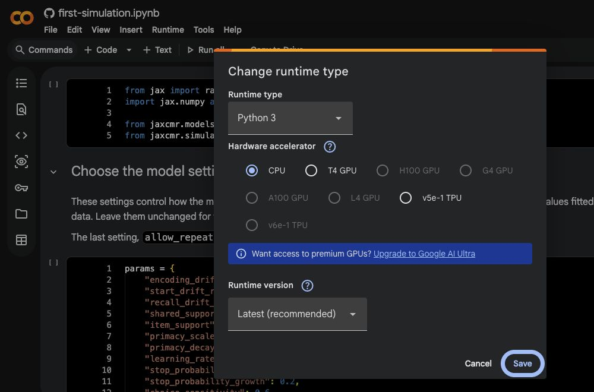
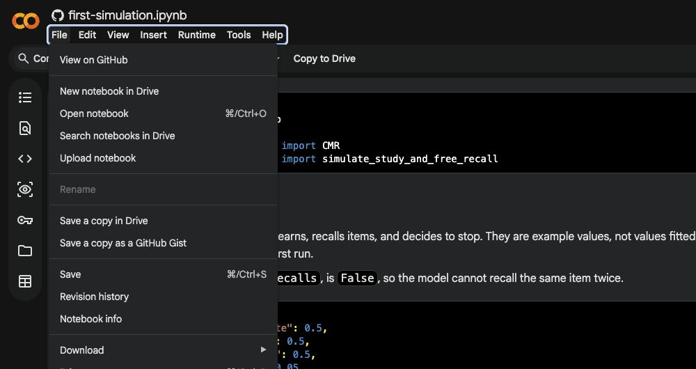
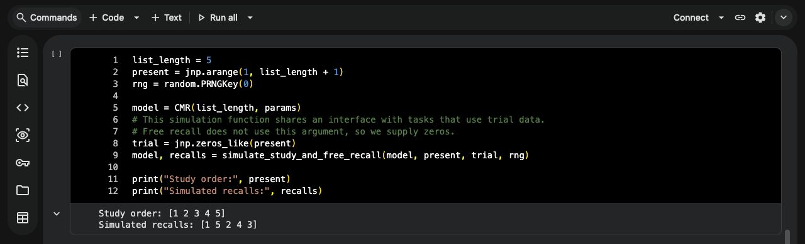

Use [Google Colab](https://colab.research.google.com/) to write and run notebooks, work with your own data, and keep results for later. Colab runs Python on Google's computers through your web browser. You need a Google account and an internet connection; you do not need to install Python or an editor on your computer.

This guide covers the workspace you will use for JAXCMR tutorials and your own analyses. No previous Colab experience is assumed. The screenshots use dark mode; the same controls are available in light mode. Red boxes highlight controls, and clicking an image enlarges it.

## 1. Create and work in a notebook

A **Jupyter notebook** is a document ending in `.ipynb`. It combines **text cells** for explanations with **code cells** containing Python instructions. Results appear beneath the code that produced them.

- **Start your own notebook:** open [Colab](https://colab.research.google.com/), sign in, and choose **New notebook**. From an open notebook, use **File → New notebook in Drive**. Click its title to give it a useful name.
- **Adapt a supplied notebook:** open its **Open in Colab** link, then choose **File → Save a copy in Drive**. Work in your copy; the original on GitHub stays unchanged.
- **Continue an existing notebook:** open it from Google Drive, or choose **File → Open notebook**. Use **File → Upload notebook** for an `.ipynb` file on your computer.

{#fig-colab-copy-dark fig-alt="Colab File menu with New notebook in Drive and Save a copy in Drive outlined in red." width=100%}

Use **+ Code** or **+ Text** in the toolbar to add a cell below the selected one. Click inside a code cell to edit it; double-click a text cell to edit its explanation. Run a code cell with its triangle button or **Shift+Enter**. **Runtime → Run all** runs the notebook from top to bottom.

Cells share Python's memory within the same session. If you change a value in an earlier cell, run that cell and the later cells that use it. Editing text in a code cell alone does not update its results. Keep setup and imports near the top, followed by loading data, calculations, and saving results, so the notebook can run in order. Stop and resolve an error before running dependent cells.

## 2. Prepare the runtime

The **runtime** is the remote computer running your code. Your notebook can be saved in Drive while its runtime is temporary. Opening a notebook does not recreate the Python variables or installed packages from its last session.

Choose **Runtime → Change runtime type**, select **Python 3** and **CPU**, and save. CPU is sufficient to get started with JAXCMR. Click **Connect** if the notebook is not already connected. JAXCMR requires Python **3.12 or later**; use the latest runtime version if installation reports an older Python.

{#fig-colab-runtime-dark fig-alt="Colab runtime settings with Python 3 and CPU outlined in red." width=100%}

In a new notebook, add this as your first code cell and run it:

```python
%pip install "jaxcmr @ git+https://github.com/githubpsyche/jaxcmr.git@main" pandas
```

`%pip` installs packages into this runtime. This installs the JAXCMR version covered by the documentation and its dependencies; `pandas` provides the table-reading and writing tools used below. Wait for installation to finish. If Colab requests a restart, use **Runtime → Restart session**, then run your imports and subsequent cells. Repeat installation when you receive a fresh runtime.

Our Colab-enabled notebooks already contain installation cells; keep and run those instead of adding a duplicate. Templates also fetch their supplied example inputs when their setup cells run. Those downloads do not provide your own research files. Installing JAXCMR makes the library available; each notebook still needs code to import the tools it uses and load its inputs.

## 3. Make your files available

Saving a notebook in Drive does not automatically give Python access to nearby files. Choose how the runtime will reach your inputs and where it will keep outputs:

| Location | What it is for | Available after the runtime is deleted? |
|---|---|---|
| Notebook saved in Drive | Code, explanations, and saved cell outputs | Yes; Python's running state is not included. |
| Runtime storage, usually under `/content` | Temporary uploads, downloads, and working files | No. |
| Connected Google Drive | Project inputs and results you want to keep | Yes; reconnect Drive in a fresh runtime. |

### Use Drive for an ongoing project

In [Google Drive](https://drive.google.com/), use **New → New folder** to create a project folder. Give it a name such as `memory-project`, create `data` and `results` folders inside it, and upload your input files into `data`. You can keep your notebooks in the project folder too.

Near the top of your notebook, after installation, add and run:

```python
from google.colab import drive

drive.mount("/content/drive")
```

Follow Colab's prompts to connect your Google account. This makes your Drive files accessible to code in the notebook, so connect it only for notebooks you trust. After the connection succeeds, **My Drive** is available at `/content/drive/MyDrive`. Files written there are stored in Drive.

Open the **Files** panel using the folder icon on the left. Expand `drive`, then `MyDrive`, to find your project. Use the panel's refresh button if a new file has not appeared. Right-click a file and choose **Copy path** to obtain the location you can use in Python.

{#fig-colab-file-actions fig-alt="Colab Files panel in dark mode with Copy path and Download outlined in red in a file's menu." width=100%}

### Upload directly for occasional work

If you prefer to keep files on your own computer, click **Upload to session storage** at the top of the Files panel and select your inputs. Use **Copy path** on the uploaded file. These uploads are temporary: upload them again in a fresh runtime, and download any results you want to keep before leaving it.

See [Colab's file and Drive guidance](https://colab.research.google.com/notebooks/io.ipynb) for other storage options.

## 4. Set input and output paths

A **path** is a file or folder's address. `/content/drive/MyDrive/memory-project/data/trials.csv` identifies a particular file; `data/trials.csv` is a *relative* path, interpreted from Python's current working folder. The folder containing the notebook in Drive does not set that working folder.

Keep your locations together in a cell near the top of each notebook. Adapt this pattern to your own folder and filename:

```python
from pathlib import Path

project = Path("/content/drive/MyDrive/memory-project")
input_path = project / "data" / "trials.csv"
output_dir = project / "results"
output_dir.mkdir(parents=True, exist_ok=True)

print("Input file exists:", input_path.is_file())
print("Save results in:", output_dir)
```

`Path` builds file locations; `/` joins their parts. The `mkdir` line creates the output folder if needed. Replace `memory-project` and `trials.csv` with your names, preserving spelling and capitalization. The input check should print `True`; if it prints `False`, inspect the Files panel and compare the copied path. This pattern also works with an uploaded file: set `input_path` to its copied path, and choose an output location separately.

For a CSV table, a later cell can read the file into Python:

```python
import pandas as pd

table = pd.read_csv(input_path)
table.head()
```

The `import` line makes pandas available under the short name `pd`. `table` holds the data in memory; `head()` displays its first few rows. Reading other formats requires a suitable reader. [Preparing data for JAXCMR](tutorials/data-preparation.ipynb) explains how to turn study and recall records into the dataset format JAXCMR uses.

When adapting a JAXCMR template, edit its existing configuration cell. Set `project_root` to your project folder's full path, `data_path` to your prepared dataset, and `output_dir` to a results folder. Relative paths in those templates are resolved against `project_root`. Check any additional output settings, such as `simulation_dir` or `figure_dir`, too. The example-input downloader leaves custom paths alone; you must make those files available yourself.

## 5. Save files and use them again

Displaying a table or figure beneath a cell is different from writing a file. **File → Save** keeps the notebook and its displayed outputs; it does not collect every file the code creates.

To write the table loaded above as a separate CSV file:

```python
saved_path = output_dir / "trials-copy.csv"
table.to_csv(saved_path, index=False)
print(saved_path)
```

This writes the current contents of `table`; `index=False` omits pandas' extra row-number column. After an analysis, use the same pattern with its result table and a meaningful filename. A figure needs its own save operation, such as Matplotlib's `savefig`; JAXCMR templates write files according to their output settings. A printed path tells you where to find each saved file.

Choose a new filename or results folder for runs you want to keep separately. Writing to an existing filename can replace its contents.

For Drive outputs, wait for writing to finish and check that the files appear in Google Drive before ending the session. For temporary outputs, right-click each file in Colab's **Files** panel and choose **Download**. This downloads the data or result file. **File → Download → Download .ipynb** downloads the notebook itself.

{#fig-colab-save-dark fig-alt="Colab File menu with Save and Download outlined in red." width=100%}

A later notebook can reuse the saved CSV without repeating the calculations that created it. After connecting Drive and defining the same `project` location, load it with:

```python
import pandas as pd

saved_table = pd.read_csv(project / "results" / "trials-copy.csv")
```

For a later JAXCMR template, set its input path to the appropriate file produced by the earlier notebook. Notebooks do not automatically share Python variables or temporary files; saved files provide the connection between them.

## 6. Return to your work

Open your saved notebook from Drive. In a fresh runtime:

1. Run the installation cell and your imports.
2. Reconnect Drive, or upload your local inputs again.
3. Run the cells defining your paths and loading data or saved results.
4. Run the calculations you need, then save new outputs.

**Runtime → Restart session** clears Python's variables but keeps packages and files in the current runtime. A replacement runtime starts afresh: its installed packages and temporary files are gone. Your saved notebook and Drive files remain. Results already visible in a notebook may be from an earlier session. [Colab's FAQ](https://research.google.com/colaboratory/faq.html) explains runtime lifetimes and storage.

For your own notebooks, use **Run all** when you intend to repeat the entire workflow. To resume from saved results, load those files and run the subsequent cells rather than automatically rerunning an expensive calculation.

## Continue with JAXCMR

Use [Preparing data for JAXCMR](tutorials/data-preparation.ipynb) to learn the library's data format, then the [templates](templates.qmd) for analysis and modelling. Their setup cells prepare the supplied examples. Apply the file and output settings above when you move to your own work.

::: {.callout-note collapse="true"}
## Optional: check installation with the supplied simulation

[Open the first simulation in Colab](https://colab.research.google.com/github/githubpsyche/jaxcmr/blob/main/guide/examples/first-simulation.ipynb), save your own copy, and choose **Run all**. Its installation cell prepares the runtime; no input file is needed. The final cell should print:

```text
Study order: [1 2 3 4 5]
Simulated recalls: [1 5 2 4 3]
```

{#fig-colab-notebook-controls fig-alt="Colab notebook with Run all and the simulation output outlined in red." width=100%}

The notebook's **Read the output** section explains the simulation. Completing this check verifies installation; use the earlier sections to work with your own notebooks and files.

:::

## If something goes wrong

- **No module named jaxcmr:** run the installation cell in the current runtime, then your imports.
- **A name is not defined:** run the earlier cell that defines it. Variables do not carry over from another notebook or a restarted session.
- **File not found:** check that Drive is connected or the file uploaded, then compare the path with **Copy path** in the Files panel.
- **Results disappeared:** reopen files saved in Drive or downloaded to your computer. Files kept only in a deleted runtime cannot be recovered by reopening the notebook.

If you ask for help, include the cell you ran and the complete error message.
